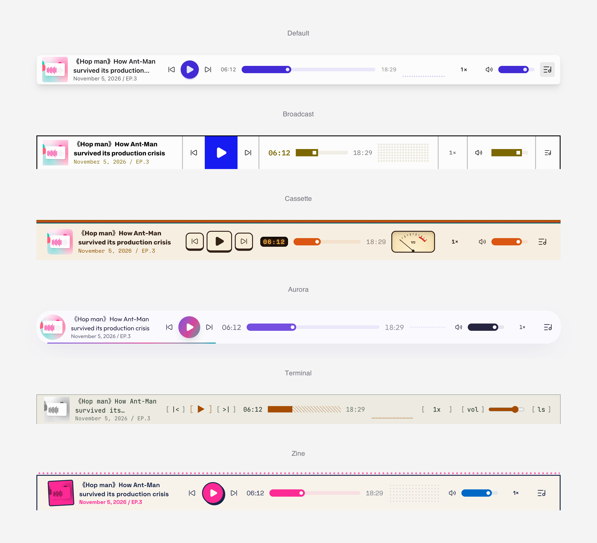

# A Ripple Song

[A Ripple Song](https://aripplesong.com/) adds podcast publishing to WordPress. Publish episodes on your site, submit a single RSS feed to Apple Podcasts, Spotify, and other directories, and give listeners a player at the bottom of every page.

The plugin works with any WordPress theme. For episode cards, show pages, and a matching player, explore the [dedicated podcast themes](https://aripplesong.com/themes/).

<picture>
  <source media="(prefers-color-scheme: dark)" srcset="screenshots/players-hero-dark.png" />
  
</picture>

## Features

- Set up your show with a title, cover art, description, language, and author.
- Publish an RSS feed with support for Apple Podcasts and Podcasting 2.0. The default path is `/feed/podcast/`.
- Organize episodes with categories and tags. Add transcripts, chapters, and credits for hosts and guests.
- Give listeners a site-wide player with a playlist and a Now Playing panel. Choose from 15 styles, each available in light and dark. Playback continues between pages when the active theme uses swup.
- Track play counts and trends, see your most-played episodes, and check RSS feed health from the dashboard.
- Set a release schedule and add subscription links for more than 30 platforms.
- The plugin is ready for translation into other languages.

## Installation

| Requirement | Minimum version |
| --- | --- |
| WordPress | 6.6 |
| PHP | 8.2 |

### Upload the ZIP from WordPress.org

1. Download the plugin from WordPress.org as [`a-ripple-song.zip`](https://downloads.wordpress.org/plugin/a-ripple-song.zip).
2. In the WordPress dashboard, go to **Plugins → Add New Plugin → Upload Plugin**.
3. Upload the ZIP file and click **Install Now**, then activate the plugin.

### Install from the WordPress dashboard

1. Go to **Plugins → Add New Plugin**.
2. Search for **A Ripple Song** and click **Install Now**.
3. Activate the plugin.

### Install with WP-CLI

If you have WP-CLI installed, run this command from the root directory of your WordPress site.

```bash
wp plugin install a-ripple-song --activate
```

Once you activate the plugin, the WordPress dashboard shows two new menus. Use **A Ripple Song** to configure your show and **Episodes** to manage episodes.

To set up your show and publish your first episode, see the [quick-start guide](https://aripplesong.com/docs/getting-started/quick-start/).

## Development

Install dependencies.

```bash
npm install
```

Run the watchers you need to rebuild assets as you edit them.

```bash
npm run watch:css
npm run watch:js
npm run watch:waveform
```

Build production assets.

```bash
npm run build
```

Compile the translations.

```bash
wp i18n make-mo resources/lang
```

Package the plugin as a ZIP file.

```bash
npm run zip
```

Pass the version number to the release script. GitHub Actions publishes the ZIP file.

```bash
npm run release 0.5.1
```

## Tech Stack

- [WordPress Plugin API](https://developer.wordpress.org/plugins/)
- [esbuild](https://esbuild.github.io/)
- [PostCSS](https://postcss.org/)
- [Tailwind CSS](https://tailwindcss.com/)
- [daisyUI](https://daisyui.com/)
- [Howler.js](https://howlerjs.com/)
- [wavesurfer.js](https://wavesurfer.xyz/)
- [Lucide](https://lucide.dev/)

## Project Structure

- `app/`: plugin logic.
- `resources/templates/`: PHP templates.
- `resources/assets/`: player scripts, styles, and icons.
- `resources/lang/`: translation files.
- `public/dist/`: built assets.
- `bin/`: build, packaging, and release scripts.

## Links

- Repository: [github.com/jiejia/a-ripple-song](https://github.com/jiejia/a-ripple-song)
- Website: [aripplesong.com](https://aripplesong.com/)

## Languages

- [English](README.md)
- [简体中文](README.zh.md)

## License

Released under the [GNU General Public License v3.0](LICENSE).
