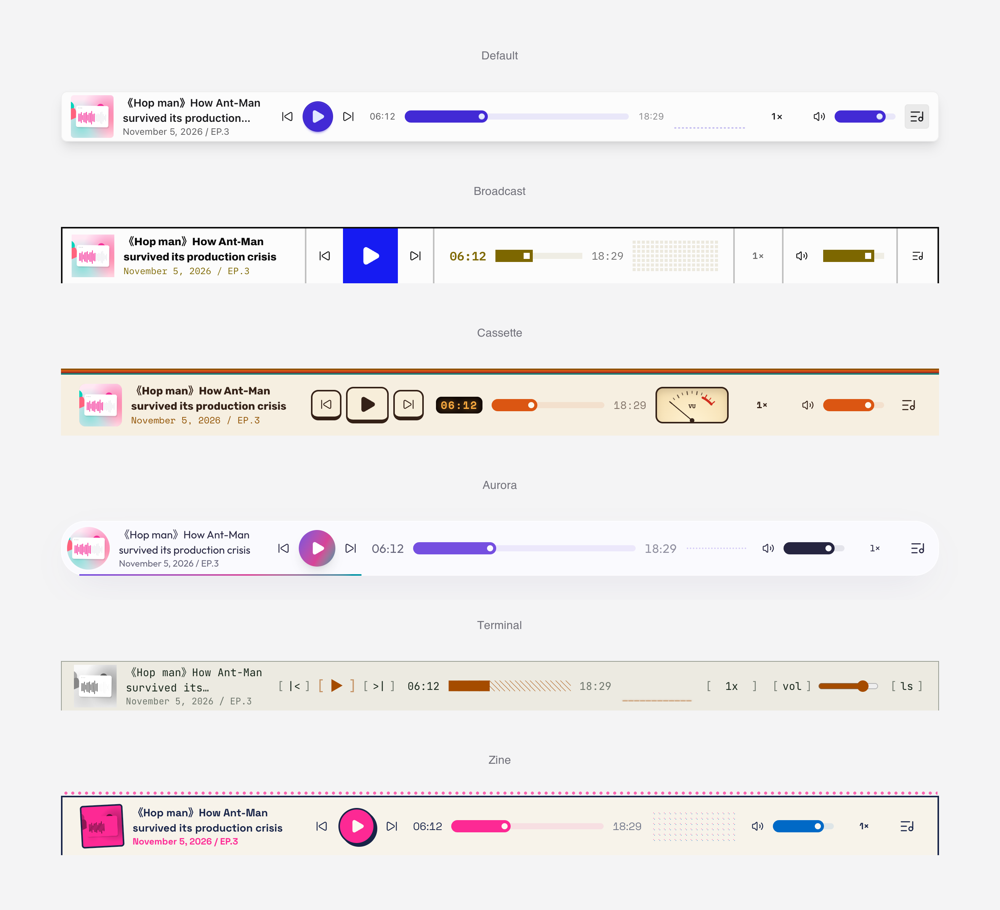

# A Ripple Song

A Ripple Song is a WordPress podcast plugin: episode publishing, an Apple Podcasts and Podcasting 2.0 RSS feed, a site-wide audio player, and play statistics.

<picture>
  <source media="(prefers-color-scheme: dark)" srcset="screenshots/players-hero-dark.png" />
  
</picture>

## Overview

Publish episodes, submit one feed to Apple Podcasts, Spotify, and other directories, and let visitors listen through a player bar on every page. Works with any theme; themes can restyle or take over the player.

## Features

- `Episodes` post type (under `/podcasts/`) with tags and episode categories.
- Duration, file size, and MIME type detected automatically for local audio.
- Episode metadata: cover, type, episode/season numbers, explicit flag, iTunes fields, subtitle, and summary.
- Podcasting 2.0 fields: transcript, chapters, soundbites, GUID, hosts, and guests.
- `/feed/podcast/` RSS feed with iTunes and Podcasting 2.0 tags.
- Cover images validated against Apple's artwork rules.
- Global player bar with playlist and "Now Playing" panel; continuous playback with swup themes.
- 15 player styles in light and dark, with bar, spectrum, or waveform progress.
- Playback position and playlist restored on the next visit.
- Deduplicated play counting, a statistics dashboard, and feed health checks.
- Subscription links for 30+ platforms and a release schedule.
- English and Simplified Chinese translations.

## Theme Integration

- Override templates by copying them from `resources/templates/` to `{theme}/a-ripple-song/`.
- `add_theme_support( 'a-ripple-song-player' )` lets a theme style the player itself.
- A theme folder named after a player style (such as `ars-petal`) selects that style.
- Hooks such as `a_ripple_song_play_counted` allow extension. See `README.txt` for the full list.

## Installation

### Release package

1. Download `a-ripple-song.zip`.
2. Go to `Plugins > Add New Plugin > Upload Plugin`.
3. Upload, install, and activate it.
4. Configure the feed in `A Ripple Song > Podcast Settings`.

### Publishing your podcast

1. Fill in the show details in `A Ripple Song > Podcast Settings`.
2. Optionally configure host, subscription, and player settings.
3. Add episodes from `Episodes > Add New Episode`.
4. Submit the feed URL (default `https://your-site.example/feed/podcast/`) to podcast directories.

### Runtime requirements

- WordPress `6.6+`
- PHP `8.2+`

## Development

```bash
npm install
```

Watch during development:

```bash
npm run watch:css
npm run watch:js
npm run watch:waveform
```

Build production assets:

```bash
npm run build
```

Compile translations:

```bash
wp i18n make-mo resources/lang
```

Build the plugin zip:

```bash
npm run zip
```

Release a new version (GitHub Actions publishes the zip):

```bash
npm run release 0.5.1
```

## Tech Stack

- [WordPress Plugin API](https://developer.wordpress.org/plugins/)
- [esbuild](https://esbuild.github.io/)
- [PostCSS](https://postcss.org/)
- [Tailwind CSS](https://tailwindcss.com/)
- [daisyUI](https://daisyui.com/)
- [Howler.js](https://howlerjs.com/)
- [wavesurfer.js](https://wavesurfer.xyz/)
- [Lucide](https://lucide.dev/)

## Project Structure

- `app/`: plugin logic.
- `resources/templates/`: PHP templates.
- `resources/assets/`: player scripts, styles, and icons.
- `resources/lang/`: translation files.
- `public/dist/`: built assets.
- `bin/`: build, packaging, and release scripts.

## Links

- Repository: [github.com/jiejia/a-ripple-song](https://github.com/jiejia/a-ripple-song)
- Website: [aripplesong.com](https://aripplesong.com/)

## Languages

- [English](README.md)
- [简体中文](README.zh.md)

## License

Released under the [GNU General Public License v3.0](LICENSE).
