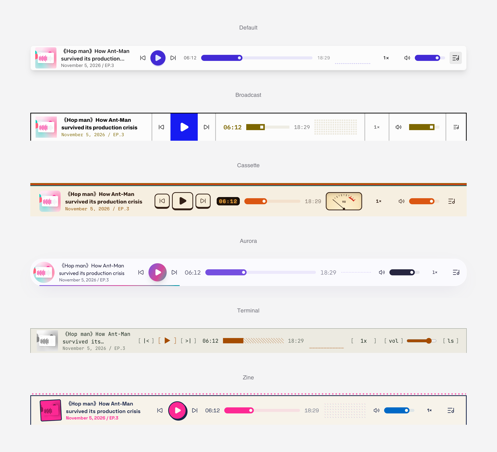

# A Ripple Song

A Ripple Song 是一个 WordPress 播客插件：节目发布、兼容 Apple Podcasts 与 Podcasting 2.0 的 RSS Feed、全站音频播放器和播放统计。

<picture>
  <source media="(prefers-color-scheme: dark)" srcset="screenshots/players-hero-dark.png" />
  
</picture>

## 概述

发布节目，向 Apple Podcasts、Spotify 等平台提交同一个 Feed，访客可通过每个页面底部的播放条收听。适用于任意主题，主题也可重设或接管播放器。

## 功能特性

- `Episodes` 文章类型（位于 `/podcasts/`），支持标签和节目分类。
- 自动识别本站音频的时长、文件大小和 MIME 类型。
- 节目元数据：封面、类型、集数/季数、Explicit 标记、iTunes 字段、副标题和摘要。
- Podcasting 2.0 字段：文字稿、章节、精彩片段、GUID、主播和嘉宾。
- `/feed/podcast/` RSS Feed，输出 iTunes 与 Podcasting 2.0 标签。
- 按 Apple 封面规范校验封面图。
- 全站播放条，支持播放列表和 “Now Playing” 面板；配合 swup 主题可跨页连续播放。
- 15 种浅色/深色播放器样式，进度可显示为进度条、频谱或波形。
- 下次访问时恢复播放进度和播放列表。
- 去重的播放统计、统计面板和 Feed 健康检查。
- 30 多个平台的订阅链接和更新周期设置。
- 英文和简体中文语言文件。

## 主题集成

- 将模板从 `resources/templates/` 复制到 `{theme}/a-ripple-song/` 即可覆盖。
- 主题声明 `add_theme_support( 'a-ripple-song-player' )` 后可自行设计播放器样式。
- 主题文件夹与播放器样式同名时（如 `ars-petal`）会自动选中该样式。
- 提供 `a_ripple_song_play_counted` 等钩子用于扩展，完整列表见 `README.txt`。

## 安装

### 安装发布包

1. 下载 `a-ripple-song.zip`。
2. 进入 `插件 > 安装插件 > 上传插件`。
3. 上传、安装并启用。
4. 在 `A Ripple Song > Podcast Settings` 中配置 Feed。

### 发布你的播客

1. 在 `A Ripple Song > Podcast Settings` 中填写节目信息。
2. 按需配置主播、订阅和播放器设置。
3. 在 `Episodes > Add New Episode` 中添加节目。
4. 将 Feed 地址（默认 `https://your-site.example/feed/podcast/`）提交到各播客平台。

### 运行环境要求

- WordPress `6.6+`
- PHP `8.2+`

## 开发

```bash
npm install
```

开发时监听变化：

```bash
npm run watch:css
npm run watch:js
npm run watch:waveform
```

构建生产资源：

```bash
npm run build
```

编译语言文件：

```bash
wp i18n make-mo resources/lang
```

构建插件 zip 包：

```bash
npm run zip
```

发布新版本（由 GitHub Actions 发布 zip 包）：

```bash
npm run release 0.5.1
```

## 技术栈

- [WordPress Plugin API](https://developer.wordpress.org/plugins/)
- [esbuild](https://esbuild.github.io/)
- [PostCSS](https://postcss.org/)
- [Tailwind CSS](https://tailwindcss.com/)
- [daisyUI](https://daisyui.com/)
- [Howler.js](https://howlerjs.com/)
- [wavesurfer.js](https://wavesurfer.xyz/)
- [Lucide](https://lucide.dev/)

## 项目结构

- `app/`：插件核心逻辑。
- `resources/templates/`：PHP 模板。
- `resources/assets/`：播放器脚本、样式和图标。
- `resources/lang/`：语言文件。
- `public/dist/`：构建产物。
- `bin/`：构建、打包和发布脚本。

## 链接

- 仓库地址：[github.com/jiejia/a-ripple-song](https://github.com/jiejia/a-ripple-song)
- 项目网站：[aripplesong.com](https://aripplesong.com/)

## 语言

- [English](README.md)
- [简体中文](README.zh.md)

## 许可协议

本项目基于 [GNU General Public License v3.0](LICENSE) 发布。
