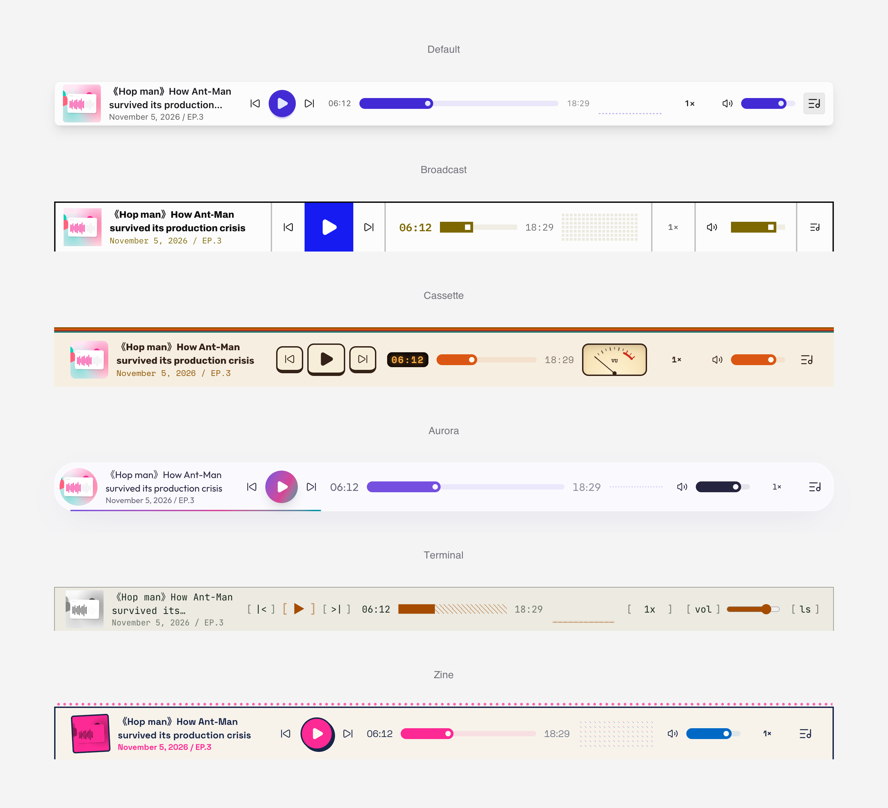

# A Ripple Song

[A Ripple Song](https://aripplesong.com/) 为 WordPress 添加播客发布功能。你可以在站内发布单集，将同一个 RSS 源提交到 Apple Podcasts、Spotify 等平台。听众可通过每个页面底部的播放器收听。

插件兼容各类 WordPress 主题。如果需要单集卡片、播客节目页和配套的播放器样式，可以查看[播客专用主题](https://aripplesong.com/themes/)。

<picture>
  <source media="(prefers-color-scheme: dark)" srcset="screenshots/players-hero-dark.png" />
  
</picture>

## 主要功能

- 设置节目的标题、封面、简介、语言和作者。
- 生成支持 Apple Podcasts 和 Podcasting 2.0 的 RSS 源，默认路径为 `/feed/podcast/`。
- 用分类和标签管理单集，并添加文字稿、章节、主播和嘉宾信息。
- 全站播放器提供播放列表和「正在播放」面板，有 15 种样式可选，每种都有浅色和深色版本。搭配使用 swup 的主题，切换页面时播放不会中断。
- 在仪表盘查看播放量、播放趋势、播放量最高的单集，以及 RSS 源的健康检查结果。
- 设置节目更新周期，并添加 30 多个平台的订阅链接。
- 支持国际化。

## 安装

| 环境 | 最低版本 |
| --- | --- |
| WordPress | 6.6 |
| PHP | 8.2 |

### 下载并上传 ZIP 安装包

1. 从 WordPress.org 下载插件安装包 [`a-ripple-song.zip`](https://downloads.wordpress.org/plugin/a-ripple-song.zip)。
2. 在 WordPress 后台打开 **插件 → 安装插件 → 上传插件**。
3. 上传 ZIP 文件，点击 **立即安装**，然后启用插件。

### 从 WordPress 后台安装

1. 打开 **插件 → 安装插件**。
2. 搜索 **A Ripple Song**，点击 **立即安装**。
3. 启用插件。

### 使用 WP-CLI 安装

如果已安装 WP-CLI，在 WordPress 站点根目录运行以下命令即可安装并启用插件。

```bash
wp plugin install a-ripple-song --activate
```

启用插件后，在后台的 **A Ripple Song** 菜单中配置节目，在 **播客**（Episodes）菜单中管理单集。

要设置节目并发布第一集，请参阅[快速入门指南](https://aripplesong.com/docs/getting-started/quick-start/)。

## 开发

安装依赖。

```bash
npm install
```

按需运行以下命令，修改文件后会自动重新构建相应资源。

```bash
npm run watch:css
npm run watch:js
npm run watch:waveform
```

构建用于发布的资源。

```bash
npm run build
```

编译翻译文件。

```bash
wp i18n make-mo resources/lang
```

将插件打包为 ZIP 文件。

```bash
npm run zip
```

发布时，将版本号传给发布脚本。GitHub Actions 会发布 ZIP 安装包。

```bash
npm run release 0.5.1
```

## 技术栈

- [WordPress Plugin API](https://developer.wordpress.org/plugins/)
- [esbuild](https://esbuild.github.io/)
- [PostCSS](https://postcss.org/)
- [Tailwind CSS](https://tailwindcss.com/)
- [daisyUI](https://daisyui.com/)
- [Howler.js](https://howlerjs.com/)
- [wavesurfer.js](https://wavesurfer.xyz/)
- [Lucide](https://lucide.dev/)

## 项目结构

- `app/`：插件核心逻辑。
- `resources/templates/`：PHP 模板。
- `resources/assets/`：播放器脚本、样式和图标。
- `resources/lang/`：语言文件。
- `public/dist/`：构建产物。
- `bin/`：构建、打包和发布脚本。

## 链接

- 仓库地址：[github.com/jiejia/a-ripple-song](https://github.com/jiejia/a-ripple-song)
- 项目网站：[aripplesong.com](https://aripplesong.com/)

## 语言

- [English](README.md)
- [简体中文](README.zh.md)

## 许可协议

本项目基于 [GNU General Public License v3.0](LICENSE) 发布。
